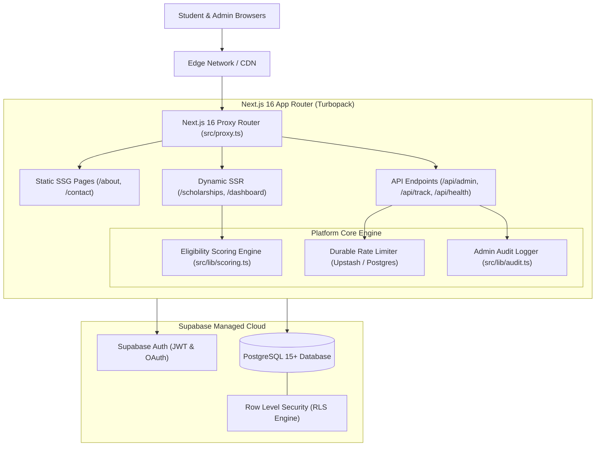

# ScholarSearch

[](https://github.com/AJVADkp/scholarship-finder/actions)
[](./LICENSE)
[](https://nextjs.org/)
[](https://www.typescriptlang.org/)
[](https://supabase.com/)

ScholarSearch is an enterprise-grade Indian scholarship discovery, verification, and eligibility-matching platform. It connects students across India with national, state, private, and institutional financial aid programs matching their academic profile, demographic category, and financial need.

---

## Live Demo & Showcase

- **Live URL**: [https://scholarsearch-demo.vercel.app](https://scholarsearch-demo.vercel.app) _(Coming Soon)_
- **Demo Admin Account**: Available on staging environments via `npm run admin:create`

---

## System Architecture

The following diagram outlines the system topology, server boundaries, and data flow across ScholarSearch:



---

## 9-Dimensional Eligibility Matching Algorithm

ScholarSearch implements a deterministic, weighted scoring algorithm (`src/lib/scoring.ts`) that evaluates student profile attributes against scholarship criteria:

```
Score = ∑ (Dimension_Score_i × Weight_i) / Total_Applicable_Weight
```

### Evaluated Dimensions & Rules

1. **Hard Exclusions (Fail-Fast Gateways)**:
   - **Gender Eligibility**: If a scholarship specifies a gender requirement (`Girls only`, `Boys only`), any non-matching profile is disqualified (`eligible = false`).
   - **State Domicile**: If a scholarship is restricted to residents of specific states (e.g. Kerala, Maharashtra), applicants from other states are strictly disqualified.
   - **Disability Status**: Programs designated specifically for Persons with Disabilities (PwD) require an affirmative profile status.
2. **Academic Level & Stream**:
   - Matches applicant educational tiers (`Undergraduate`, `Postgraduate`, `Class 11-12`) and disciplines (`Engineering`, `Medicine`, `Arts`). Universal programs grant base credit.
3. **Academic Performance & Minimum Marks**:
   - Compares user's recorded percentage against `min_marks_percentage`. Profiles exceeding the threshold receive maximum score; close thresholds receive proportional credit.
4. **Income Ceiling Verification (`checkIncomeMatch`)**:
   - Parses complex real-world Indian income strings (e.g. `Below 6 Lakhs`, `₹4.5L to ₹8L`, `Above ₹8L`) into normalized rupee intervals `[min, max]`. Validates against user's declared family income.
5. **Caste, Religion & Special Backgrounds**:
   - Evaluates affirmative action programs (SC, ST, OBC, EWS, Minority communities, first-generation learners, single-girl children).
6. **Tiebreaking & Priority Sorting**:
   - Qualified matches (`eligible = true`) are sorted by match score descending. Scores tied in the same percentile are broken by deadline proximity (earliest closing first).

---

## Database Architecture & Data Model

ScholarSearch enforces strict Row Level Security (RLS) across all PostgreSQL tables:

| Table                | Primary Key                 | Description                                                      | RLS Policy                                             |
| :------------------- | :-------------------------- | :--------------------------------------------------------------- | :----------------------------------------------------- |
| `users`              | `id (uuid, FK auth.users)`  | Student profiles, academic credentials, and demographics         | Read/Write by owner user ID only                       |
| `scholarships`       | `id (uuid)`                 | Scholarship database indexed with GIN arrays and Trigram search  | Publicly readable; writable by Admin Service Role only |
| `saved_scholarships` | `(user_id, scholarship_id)` | Student bookmarked opportunities                                 | Read/Write by owner user ID only                       |
| `admin_credentials`  | `id (uuid)`                 | Bcrypt-hashed administrator credentials (cost 12)                | No public access; Service Role only                    |
| `admin_audit_log`    | `id (uuid)`                 | Immutable audit ledger of admin operations and logins            | Append-only; readable by Admin Service Role only       |
| `revoked_tokens`     | `id (uuid)`                 | Blacklisted JWT `jti` tokens on admin logout                     | Service Role only                                      |
| `rate_limits`        | `(key, window_bucket)`      | Atomic counter table for durable DDoS and brute-force protection | Internal route handlers via Service Role               |
| `analytics_visits`   | `id (uuid)`                 | First-party page view analytics with salted SHA-256 hashed IPs   | Write-only anonymously; read by Admin Service Role     |
| `contact_messages`   | `id (uuid)`                 | Support inquiries validated with anti-bot honeypot fields        | Public insert with rate limiting; Admin read-only      |

### Database Indexes

- **Array GIN Indexes**: `academic_levels`, `streams`, `caste_categories`, and `special_backgrounds` leverage PostgreSQL Generalized Inverted Indexes (`gin`) for high-concurrency array containment queries (`@>`).
- **Trigram Search (`pg_trgm`)**: `title` and `provider` utilize `gin_trgm_ops` for fast, fuzzy, case-insensitive substring searching without full-table scans.

---

## Environment Variables Reference

| Variable                        | Description                                                   | Target Scope    | Example                                  |
| :------------------------------ | :------------------------------------------------------------ | :-------------- | :--------------------------------------- |
| `NEXT_PUBLIC_SUPABASE_URL`      | Supabase project API gateway URL                              | Client & Server | `https://xyzcompany.supabase.co`         |
| `NEXT_PUBLIC_SUPABASE_ANON_KEY` | Public Supabase anon client key                               | Client & Server | `eyJhbGciOi...`                          |
| `SUPABASE_SERVICE_ROLE_KEY`     | High-privilege service role key (bypasses RLS)                | **Server-Only** | `eyJhbGciOi...`                          |
| `ADMIN_JWT_SECRET`              | 32+ character high-entropy key for admin session JWTs         | **Server-Only** | `at-least-32-character-secure-key`       |
| `NEXT_PUBLIC_SITE_URL`          | Canonical domain for metadata, sitemaps, and robots           | Client & Server | `https://scholarsearch.example.com`      |
| `UPSTASH_REDIS_REST_URL`        | Optional Upstash Redis endpoint for distributed rate limiting | **Server-Only** | `https://rapid-fox-12345.upstash.io`     |
| `UPSTASH_REDIS_REST_TOKEN`      | Optional Upstash Redis token                                  | **Server-Only** | `AXz...`                                 |
| `SENTRY_DSN`                    | Optional Sentry DSN for production exception telemetry        | Client & Server | `https://key@o1234.ingest.sentry.io/567` |

---

## Deployment Guide

### 1. Supabase Setup

1. Create a project at [supabase.com](https://supabase.com).
2. Navigate to **SQL Editor** and run the baseline migrations in sequence from `supabase/migrations/`:
   - `20240101000000_baseline_schema.sql`
   - `20240102000000_phase1_security_and_audit.sql`
   - `20240103000000_phase2_indexes_and_sample_flag.sql`
3. In Supabase Dashboard, retrieve your **Project URL**, **Anon Key**, and **Service Role Key** under **Project Settings → API**.

### 2. Administrator Provisioning

Create initial administrative credentials using the secure CLI tool:

```bash
# Set environment variable in your terminal
export SUPABASE_SERVICE_ROLE_KEY="your-supabase-service-role-key"
export NEXT_PUBLIC_SUPABASE_URL="https://your-project.supabase.co"

# Run interactive admin creator
npm run admin:create
```

### 3. Vercel Deployment

1. Import your GitHub repository into Vercel.
2. In Project Settings → Environment Variables, add:
   - `NEXT_PUBLIC_SUPABASE_URL`
   - `NEXT_PUBLIC_SUPABASE_ANON_KEY`
   - `SUPABASE_SERVICE_ROLE_KEY`
   - `ADMIN_JWT_SECRET` (generate using `openssl rand -base64 32`)
   - `NEXT_PUBLIC_SITE_URL` (set to your production domain)
3. Deploy. Turbopack builds and statically optimizes all routes.

---

## Local Development & Quality Automation

### Setup

```bash
# Install dependencies
npm install

# Initialize Git hooks
npm run prepare

# Copy environment template
cp .env.example .env.local
```

### Verification Commands

```bash
# TypeScript strict type checking
npm run typecheck

# ESLint code analysis
npm run lint

# Prettier code formatting
npm run format
npm run format:check

# Vitest unit and route handler test suite (55 tests)
npm test

# Playwright end-to-end smoke tests
npm run test:e2e

# Production build verification
npm run build
```

---

## Troubleshooting

- **`ADMIN_JWT_SECRET must be at least 32 characters long`**:
  Generate a secure 32+ byte string using `openssl rand -hex 32` and assign it to `ADMIN_JWT_SECRET` in `.env.local`.
- **`Rate limit exceeded: Please wait before retrying`**:
  During rapid local testing, rate limits expire after 60 seconds. Alternatively, configure `UPSTASH_REDIS_REST_URL` or reset the `rate_limits` table in Supabase.
- **Supabase RLS Error: `new row violates row-level security policy`**:
  Ensure user requests include a valid Bearer token from Supabase Auth (`createClient()` in `@/lib/supabase/client`).
- **Stale Database Types**:
  Run `npm run db:types` to regenerate `src/lib/database.types.ts` from your active database schema.

---

## Roadmap

- [ ] Automated scraping & synchronization pipeline for National Scholarship Portal (NSP).
- [ ] Push and email notifications for approaching application deadlines.
- [ ] Multi-lingual support for major regional languages (Hindi, Tamil, Telugu, Malayalam, Bengali).
- [ ] Document repository with automated file verification against eligibility guidelines.
